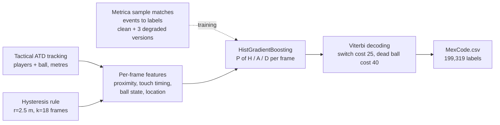

# MexCode · More Than A Hack 2027 · Initial Challenge

Frame-by-frame ball-possession labels (`H` / `A` / `D` / `X`) for the full FC Barcelona vs Athletic Club match (199,319 frames), built from the organisers' tracking data only.

## Overview

The task ([challenge](docs/reto_original/CHALLENGE.md)): label every frame of the tactical video of BAR-ATH (LaLiga 24-25, matchday 2). The score is **spellF1**, which rewards whole possessions with correct start and end, not isolated frames. The official baseline (nearest player, window ±50) scores **0.2433**.

| label | meaning |
|---|---|
| `H` | home (Barcelona) in possession, ball alive |
| `A` | away (Athletic) in possession, ball alive |
| `D` | dead ball |
| `X` | unknown (not used by our submission) |

## Approach

1. **Input**: only the tactical ATD tracking (`BAR-ATH_tactical_atd.xml/.txt`), converted to metres on a 105 × 68 pitch.
2. **Validation bench**: the rules forbid tuning on the provided match, so every parameter is calibrated on Metrica's three public sample matches (labels derived from their events, scored with the challenge's own scorer). Degraded copies of the bench imitate the noisier BAR-ATH ball (ball ~1.9 m from the nearest player, more jitter).
3. **Hysteresis rule** (`src/histeresis.py`): a team controls the ball when a player is within 2.5 m. Possession changes only after the other team controls it for 18 consecutive frames. Ball missing from tracking for more than 1 s ⇒ dead. Used as a classifier input.
4. **Per-frame classifier** (`src/segmentos.py`): `HistGradientBoostingClassifier` (`random_state=0`) gives P(H/A/D) from ball state, proximity, touch timing, ball dynamics, pitch location and rolling means. Trained on 3 matches × 4 versions (clean, smooth drift, jumps, extra gaps), mirrored home/away.
5. **Viterbi decoding**: three states, cost 25 for H↔A switches and 40 for entering or leaving D. This yields few, well-placed possessions.
6. **Missing ball** (41% of frames): handled with gap length and position inside the gap; mostly decoded as `D`.



Not used in the submitted pipeline: Smart Tagging, homography, tactical video and the ball detector in `tools/` (tried and dropped). Full rationale: [docs/technical_document.md](docs/technical_document.md) and [docs/COMO_FUNCIONA.md](docs/COMO_FUNCIONA.md) (Spanish).

## Results

There is no leaderboard and we did **not** score the public 5-minute window (used only to check format and alignment), so we report no BAR-ATH macroF1/spellF1 for our file. Numbers below are spellF1 on the external Metrica bench, always out of sample (each match predicted by a model trained on the other two).

| method | clean bench | degraded bench | unseen-noise bench |
|---|---|---|---|
| official baseline (window 50) | 0.383 | 0.323 | – |
| hysteresis r=1.0 m, k=8 | 0.589 | 0.377 | – |
| classifier + Viterbi, v1 | 0.623 | 0.486 | – |
| v2 (+ touch timing, location) | 0.611 | 0.534 | 0.387 |
| **v3 (submitted)** | 0.587 | 0.529 | **0.441** |

Official baseline on BAR-ATH (organisers): spellF1 0.2433. Our submission reports 333 possessions, mean 16.8 s; the file passes the official validator.

## Repository structure

```
src/          Metrica bench, hysteresis rule, features, Viterbi; generar_v3.py produces MexCode.csv
              generar_v0/v1/v2.py: previous versions, kept for traceability of the calibration (grids in v1/v2)
tools/        experimental ball detector, tried and dropped; not used to produce MexCode.csv
docs/         technical_document.md, COMO_FUNCIONA.md, bitacora/ (log), reto_original/ (organisers' docs)
evaluation/   official scorer and validator (unchanged), public 5-min GT, baselines
starter/      official loaders and notebooks (unchanged)
games.py      official helper
reproducir.sh one-command reproduction
requirements-nuestro.txt   pinned dependencies for the submission
```

## Installation

Python 3.11+ (tested on 3.13), git, ~3 GB free RAM. `reproducir.sh` creates the virtual environment itself; manual install:

```bash
python3 -m venv .venv-repro && source .venv-repro/bin/activate
pip install -r requirements-nuestro.txt
```

Pinned: `numpy==2.5.3`, `pandas==3.0.5`, `scikit-learn==1.9.1`, `kloppy==3.18.0`.

## Data

⚠️ The match data is **not** in this repository (not redistributable) and `data/`, `outputs/`, `models/`, `data_externa/` and `*.mp4` are in `.gitignore`. Get it from the organisers' bundle and place it as:

```
data/tactical/BAR-ATH_tactical_atd.xml
data/tactical/BAR-ATH_tactical_atd.txt
```

(The video, homography and Smart Tagging files are not needed.) Calibration data, Metrica's [sample-data](https://github.com/metrica-sports/sample-data), is downloaded by the script at fixed commit `e706dd506b360d69d9d123d5b8026e7294b13996`.

## Reproduce

```bash
bash reproducir.sh MexCode      # ~4 min on a laptop, CPU only; writes outputs/MexCode.csv and validates it
```

It downloads the Metrica data, runs `src/generar_v3.py` (fixed seeds, `random_state=0`) and then the validator. Expected md5 of the output: `6cb2046fe5924ae3878a475281a68c23`.

Validate manually:

```bash
python evaluation/validate_submission.py outputs/MexCode.csv
```

Optional scoring against the public 5-minute window: `python evaluation/run_evaluation.py`.

## Compliance with the rules

- No labels, ground truth or video of the provided match were used for training, tuning or calibration; only input statistics of the ATD (ball–player distance, jitter) set the noise level of the external bench. See [docs/bitacora/00_reglas.md](docs/bitacora/00_reglas.md).
- No manual annotation. Training labels come from Metrica's event data.
- The full-match ground truth is not in the repo; only the organisers' public 5-minute GT (`evaluation/gt/`, MIT) is committed.
- AI tools: Claude was used as a development assistant; the pipeline itself uses no LLM.

## Limitations

- Bench labels come from events, not from the challenge's corrected tracking: boundaries will differ, especially around dead ball.
- Only three matches; the noise model may not match the real BAR-ATH error.
- Alive ball without tracking tends to be labelled `D`.
- Smart Tagging and video detections are unused because nothing external could validate them.

## Team

Team **MexCode**

| member | GitHub |
|---|---|
| Christian | [CrisWant26](https://github.com/CrisWant26) |
| Guillermo Lira | [2klira](https://github.com/2klira) |
| Diego Tamez | [datFlowers](https://github.com/datFlowers) |
| Luis Flores | [Tonyfloresc](https://github.com/Tonyfloresc) |
| Marcelo Sias | [MarceloSias05](https://github.com/MarceloSias05) |

Repository: https://github.com/MarceloSias05/mtah2027-posesion

## License

MIT, see [LICENSE](LICENSE). Covers the code, documentation and the public 5-minute ground truth only; it does not cover the match data.
