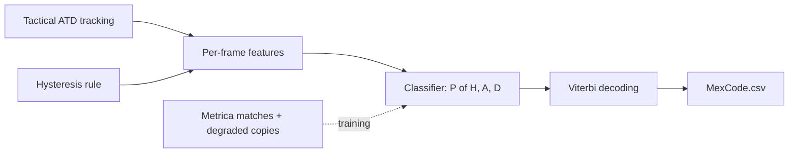

# MexCode · More than a Hack 2027 · Initial Challenge

**Frame-level ball possession for FC Barcelona vs Athletic Club**

Team: Christian ([CrisWant26](https://github.com/CrisWant26)), Guillermo Lira ([2klira](https://github.com/2klira)), Diego Tamez ([datFlowers](https://github.com/datFlowers)), Luis Flores ([Tonyfloresc](https://github.com/Tonyfloresc)), Marcelo Sias ([MarceloSias05](https://github.com/MarceloSias05))  
Repository: https://github.com/MarceloSias05/mtah2027-posesion  
Submission file: `MexCode.csv` (regenerate with `bash reproducir.sh MexCode`)

---

## At a glance

| Item | Summary |
|---|---|
| **Task** | Label each of the 199,319 frames of BAR-ATH as `H`, `A` or `D` (we never output `X`). Ranked on spellF1. |
| **Input used** | Only the tactical ATD tracking of the provided match. |
| **Method** | Hysteresis control rule and tracking features, a gradient-boosted per-frame classifier, then Viterbi decoding that charges for every change of owner. |
| **Training data** | Metrica Sports' three public sample matches (labels from their event data) plus degraded copies of them. Nothing from the provided match. |
| **Output** | 333 possessions, mean 16.8 s. Home 43.8%, away 26.2%, dead ball 30.0% of frames. |
| **Evidence** | Out-of-sample spellF1 on the external bench: 0.529 on the degraded bench and 0.441 on an unseen-noise bench, against 0.323 for the official baseline on the degraded bench. We did not score our file on BAR-ATH, so we have no BAR-ATH number. |
| **Reproduce** | `bash reproducir.sh MexCode` (about 4 min, CPU only). Output md5 `6cb2046fe5924ae3878a475281a68c23`. |



### Rules compliance

| Rule | How we comply |
|---|---|
| No hand labels or manual corrections on the provided game | None used. Every label in the file comes from code. |
| No full-match ground truth, nothing derived from it | Not used. The public 5-minute GT only checked format and alignment and was not scored. |
| Labelled data only from other games | Metrica's sample matches, labelled by Metrica (section 6). |
| Match data not redistributed | Not in the repository; `data/` is in `.gitignore`. |
| Reproducible | Pinned dependencies, fixed seeds, byte-identical output (section 10). |
| AI use disclosed | Section 11. |

---

## 1. Approach in one paragraph

We treat possession as a segmentation problem, because that is what spellF1 rewards. A gradient-boosted classifier gives a probability of H / A / D for every frame from tracking-derived signals, and a Viterbi decoder picks the most plausible sequence of possessions over the whole match, charging a cost for every change of owner and every entry into or exit from dead ball. Since nothing could be tuned on the provided game, we built a validation bench from Metrica's three public sample matches and the official scorer. When we noticed that the challenge's automatic tracking differs from the sample data (the ball sits about 2 m from the nearest player instead of 0.3–1.3 m, and jitters much more), we added "degraded" versions of the bench whose ball statistics match the challenge input. Because the exact shape of the challenge's tracking error is unknown, the final model is trained on several kinds of degradation and its decoder costs were chosen for robustness to a degradation it was not trained on.

## 2. Why this approach

**What the metric rewards.** spellF1 matches whole possessions one-to-one against the truth. Splitting a possession in three because an opponent passed near the ball for a few frames costs two false positives and usually loses the true one as well. The official baseline shows it: unsmoothed it reports thousands of possessions and scores 0.05, although per frame it is reasonable. Our goal was *few changes of owner, placed at the right frame*.

**Why a bench.** The clarified rules forbid training, fitting or calibrating on the provided ground truth or video, and there is no leaderboard. Metrica's public sample data (github.com/metrica-sports/sample-data, commit `e706dd5`) has three matches with tracking and synchronised event data; game 3 uses the same EPTS format as the challenge. From the events we derive a label per frame in the challenge format: the team of the last pass / carry / recovery / set piece / shot / ball lost / ball out owns the ball, and the ball is dead from a ball-out, foul or goal until the next set piece. We score with the challenge's own `evaluation/possession_metrics.py`.

On this bench the official baseline ranks its four smoothing windows exactly as on BAR-ATH:

| baseline window | Metrica G1 | G2 | G3 | BAR-ATH (official) |
|---|---|---|---|---|
| 0 | 0.102 | 0.087 | 0.084 | 0.049 |
| 25 | 0.347 | 0.332 | 0.318 | 0.200 |
| **50** | **0.402** | **0.390** | **0.357** | **0.243** |
| 125 | 0.283 | 0.269 | 0.296 | 0.224 |

**Why a degraded bench.** Comparing input statistics only (no ground truth), the BAR-ATH tracking is clearly harder than the sample data:

| Source | median ball–nearest-player distance | median ball jitter (absolute change of speed per frame, m/s) |
|---|---|---|
| Metrica G1 / G2 | 0.28 m | 0.025 / 0.026 |
| Metrica G3 | 1.27 m | 0.017 |
| BAR-ATH tactical ATD | 1.91 m | 0.167 |

(The frame ranges 11185–90652 and 110808–190198 used in `src/calibrar_ruido.py` are the graded halves published in DATA.md; they are only used for statistics of the input tracking, never of the ground truth.) A control rule tuned on the sample data ("a player within 1 m controls the ball") fires on 46–57% of ball frames there but only 28% in BAR-ATH. We therefore degrade the Metrica ball with two error terms: a slow drift (Gaussian noise smoothed over ~2 s) and frame-level jitter. The levels are chosen so that the median distance and jitter match BAR-ATH (`src/calibrar_ruido.py`): 1.25 m / 0.004 for G1 and G2, 1.0 m / 0.004 for G3. On the degraded bench the baseline drops to 0.323, closer to its real 0.243 on BAR-ATH, which suggests the degraded bench is the more realistic one.

## 3. Pipeline (`src/generar_v3.py`)

**Hysteresis rule** (`src/histeresis.py`). A player controls the ball if within *r* of it. The owner changes only when the other team controls it for *k* consecutive frames. If the ball is missing from the tracking for more than 1 s, the ball is dead. Selected on the degraded bench: r = 2.5 m, k = 18 frames (0.72 s). Its output is used as an input of the classifier.

**Per-frame features** (`src/segmentos.py`), all computable identically on Metrica and BAR-ATH:
- *ball state*: ball missing flag, length of the gap the frame sits in, time since the ball was last seen and until it is seen again
- *proximity*: distance from the ball to the nearest home and nearest away player, and their difference
- *touch timing*: time since each team last controlled the ball and time until it next does (the decoder is offline, so looking ahead is allowed), and their differences
- *ball dynamics*: ball speed, sudden speed changes (kicks), ball outside the pitch lines
- *location*: distance of the ball (or its last known position) to the nearest touchline and goal line
- *context*: mean player speed, and rolling means of the above over ±0.5 s, ±1 s and ±3 s
- the hysteresis output (one-hot H/A/D)

**Classifier.** scikit-learn `HistGradientBoostingClassifier` (200 iterations, 31 leaves, `random_state=0`), trained on every third valid frame of the three Metrica matches, each in four versions: clean; *smooth* degradation (drift + jitter, section 2); *jumps* (the tracker locks onto the wrong object: 0.5–2 s stretches with the ball displaced by ~4 m, about one every 30 s); and *gaps* (extra 0.5–3 s ball dropouts during play, about one every 20 s). The training set is mirrored (home/away features and labels swapped), so the model cannot learn that one side has the ball more often, which is a property of a particular match.

**Viterbi decoding.** Three states (H, A, D). Switching H↔A costs 25, entering or leaving D costs 40 (log-probability units). Section 4 explains the choice.

**Application to BAR-ATH.** The final model is trained on all twelve match versions and applied once to the tactical ATD. Coordinates are converted to metres with a 105 × 68 pitch.

## 4. Results on the external bench

All numbers are out of sample: each Metrica match is predicted by a pipeline trained only on the other two. The *unseen-noise* bench applies a stronger mix of all degradations (drift ×1.4, double jitter, 6 m jumps more often, more gaps) that no model is trained on.

| method | clean | degraded (smooth) | unseen noise |
|---|---|---|---|
| official baseline (window 50) | 0.383 | 0.323 | – |
| hysteresis r=1.0 m, k=8 | 0.589 | 0.377 | – |
| hysteresis r=2.5 m, k=18 | – | 0.443 | – |
| classifier + Viterbi, proximity features only (r=1.0) | 0.623 | 0.486 | – |
| + touch timing and location (r=1.0) | 0.671 | 0.507 | – |
| + touch timing and location (r=2.5), trained clean + smooth, costs 18/12 | 0.611 | 0.534 | 0.387 |
| same, costs 25/40 | 0.603 | 0.542 | 0.417 |
| **trained on clean + smooth + jumps + gaps, costs 25/40 (submitted)** | 0.587 | 0.529 | **0.441** |

Two observations drove the final choice. Higher switching costs consistently held up better under the unseen noise, and training on more kinds of degradation helped there too, at a small cost on the known degradation. Since the BAR-ATH input is clearly not clean (section 2) and the shape of its error is unknown, we picked the configuration with the best worst case across the two degraded benches. Note that this makes the unseen-noise bench part of the selection among five candidates; nothing was fine-tuned on it.

The classifier alone, without the Viterbi decoder, scores around 0.3: decoding is the step that makes the difference.

We did not score our submission on the public 5-minute ground truth. It was used only to check alignment and format. On BAR-ATH the submission reports 333 possessions with a mean of 16.8 s, and Barcelona holds about 62% of alive-ball time.

## 5. Assets used and dropped

| asset | used? | how |
|---|---|---|
| tactical ATD | yes | the only input of the submitted pipeline |
| tactical ATD statistics | yes | to set the degradation level of the external bench (input statistics only) |
| tactical video + homography | explored, not submitted | ball detection in frames without an ATD ball (section 7) |
| Smart Tagging | no | no counterpart in the external data, so any use would be unvalidated |
| broadcast video / ATD | no | not synchronised to the tactical timeline |
| team shape (width, length, advance, forward speed) | tried, dropped | 0.608 vs 0.623 on the clean bench |
| asymmetric dead-ball costs, dead-ball bias | tried, dropped | no gain once the choice was cross-validated (0.617 vs 0.623) |
| larger classifier (400 iterations, 63 leaves) | tried, dropped | 0.668 vs 0.671 |
| smoothing the ball (rolling median ±3 / ±8 frames) | tried, dropped | worse on every bench (unseen noise 0.408 / 0.376 vs 0.417); it erases real kicks |
| minimum possession duration in the decoder (12 / 25 frames) | tried, dropped | no gain over higher switching costs |
| averaging two models | tried, dropped | in between the two (0.426 unseen) |

## 6. Training data

No labelled data from the provided game was used anywhere. No hand labels or manual corrections of the provided game's tracking were used, and no external data about this match (event data, other tracking) was used.

| dataset | source | labelled by | amount | used for |
|---|---|---|---|---|
| Metrica Sports sample data, games 1–3 | github.com/metrica-sports/sample-data @ e706dd5 | Metrica Sports (event data) | 3 matches, ~430k frames | possession labels derived from events; training and every parameter choice |
| same, degraded copies (smooth, jumps, gaps, unseen mix) | generated by us from the above | – | 3 matches × 4 | training and parameter choice under BAR-ATH-like noise |
| football-ball-detection (pre-trained weights) | roboflow/sports, trained on a Roboflow Universe dataset from DFL Bundesliga videos | Roboflow | not trained by us | ball detection in the video (exploration only) |

## 7. Handling missing and noisy tracking

**Missing ball.** The ATD has no ball on 41% of graded frames, in about 150 gaps with a median of ~10 s and some over 3 minutes. During the gaps players move at half their usual speed (0.9 vs 1.9 m/s). In the Metrica data the ball is missing in 78–90% of dead-ball frames and 14–19% of alive ones, so a missing ball is mostly a dead ball. The model uses the gap, its length and the position inside it. The official baseline already exploits the same fact (no ball → D), so this is not an advantage by itself; what helps is placing the boundaries of the dead periods.

**Noisy ball.** Handled by the degraded benches and by training on clean and several kinds of degraded data together (sections 2–4). The larger control radius (2.5 m) and the higher switching costs follow from it.

**Video ball detection (not submitted).** We ran a pre-trained detector on the 64,643 frames without an ATD ball, plus 1 in 25 frames with one as an automatic agreement check. The ball is 4–9 px wide in the tactical view, so frames are split into eight 640-px tiles. When the ATD has the ball, the best candidate is within 2 m of it in 59% of frames. About half the candidates are fixed objects (penalty spots, centre spot, goal posts, an object near the touchline), removed with a physical rule: anything detected in the same square metre for more than a minute is not a ball in play. After that and a frame-to-frame speed check, 63% of gap frames keep a clean candidate, at a median of 0.8 m from the nearest player. Metrica's sample data has no video, so we could not validate its effect on possession, and it is not in the submitted pipeline.

## 8. Possession rules we implemented

The decoder works with probabilities, so these are the behaviours it was built and calibrated to produce, not hard-coded thresholds:

- **Control.** A team is considered to control the ball when its nearest player is close to it (2.5 m in the rule fed to the model, which accounts for the ball position error of the automatic tracking).
- **Change of possession.** Requires the other team to keep control for a sustained period (0.72 s in the rule). A touch, a deflection or a block not followed by control does not change possession.
- **Loose balls and long passes.** While nobody controls the ball, possession stays with the last team that did.
- **Contested balls.** Possession does not change during a duel until one side keeps the ball. If the defending team wins it, the change is placed when its control starts.
- **Dead ball.** The ball is dead when it leaves the pitch lines, and when it disappears from the tracking in a context the model recognises as a stoppage (long gap, players slowing down, ball near the lines).
- **Restarts.** After a dead ball, possession goes to the first team that controls the ball. We do not label who owns a dead ball, as the task specifies.

**Goalkeeper saves, aerial balls and throw-ins.** The code has no explicit handling of any of the three; they are only covered indirectly. The ATD gives the ball in 2D, so an aerial ball is indistinguishable from a ground ball and can look like control by the nearest player. A goalkeeper is treated like any other player: a save followed by a distribution counts as control by his team, and an uncontrolled parry does not change possession. A throw-in is only seen through the ball-outside-the-lines feature (0.5 m margin) that feeds the dead-ball state, and the restart goes to the first team that controls the ball. These cases are known limitations, not validated behaviour.

## 9. Limitations

- **The bench is not the challenge's ground truth.** Our labels come from Metrica's event data, the challenge's from its corrected tracking. Boundaries will differ, especially around dead ball.
- **Three matches.** All parameters come from three games and their degraded copies.
- **The degradation is a model.** We match the median distance and jitter of the BAR-ATH ball and train on three kinds of error, but the real error may still have a different shape (for example a ball in the air projected onto the pitch).
- **Clean-data cost.** The robust configuration loses about 0.02 on the clean bench compared with the version tuned for it.
- **Alive ball without tracking.** The model tends to call D when the ball is missing but play continues. This is where most of the remaining error is.
- **Unused signals.** Smart Tagging and the video detections could help exactly there, but we had no external data to validate them, so we preferred not to add an untested component.

With more time: the seven open DFL matches (Bassek et al., 2025), whose official tracking marks ball state and ball owner per frame, the same way the challenge ground truth is built; external data with video, to validate the ball detector end to end; and a semi-Markov decoder with learned possession durations.

## 10. Reproduction

Requirements: Python 3.11+ (tested on 3.13), git, about 3 GB of free RAM, and the challenge data in `data/tactical/` with its original file names.

```bash
bash reproducir.sh MexCode
```

This creates a virtual environment with pinned versions (`requirements-nuestro.txt`: numpy 2.5.3, pandas 3.0.5, scikit-learn 1.9.1, kloppy 3.18.0), downloads Metrica's sample data at a fixed commit, builds the degraded copies with fixed seeds, trains, writes `outputs/MexCode.csv` and runs the official validator, in about 4 minutes on a laptop. Two runs give a byte-identical file (md5 `6cb2046fe5924ae3878a475281a68c23`).

Other entry points: `python src/calibrar_ruido.py` (degradation levels), `cd src && python calibrar_histeresis.py` (hysteresis on the clean bench).

## 11. Use of AI tools

We used Claude (Anthropic) as a development assistant for code and analysis. The pipeline itself uses no LLM.
